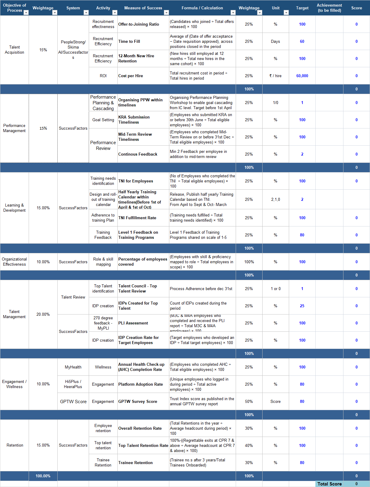

Please find attached the prototype of the Group HR Scorecard & excel sheet with formula. The Scorecard tab is the working prototype with sample data.
**Key rules to build:**

- **Structure:**
- 7 pillars weighted in the overall score - Talent Acquisition 15%, Performance Management 15%, L&D 15%, Organizational Effectiveness 10%, Talent Management 20%, Engagement/Wellness 10%, Retention 15%
- 23 sub-KPIs, each weighted within its pillar.
- **Sub-KPI score (% achieved):**
- Achievement ÷ target × 100
- For lower-is-better KPIs (Time to Fill, Cost per Hire): target ÷ achievement × 100.
- **Pillar score:**
Weighted average of the sub-KPI scores in the pillar. A sub-KPI with no value, or not yet due, is left out and the remaining weights are rescaled.
- **IC overall score:**
Weighted average of the 7 pillar scores using the pillar weights.
- **Group score:**
For each sub-KPI, the group achievement is the simple average of the IC achievements (Cost per Hire = total cost ÷ total hires), then scored.
- **Status:** 90 and above green (on track), 75 to 89.9 amber (needs attention), below 75 red (off track).
- **Due months:**
Deadline KPIs are scored only from their due month in the April–March year.
- KRA submission from June;
- Mid-term review and top talent review from December;
- Training calendar target is 1 from April and 2 from October.
- **Manual inputs(4 Sub KPIs) :**
- Cost per Hire (recruitment cost and hires),
- Top Talent Review (Yes/No and date), IDPs created (year to date)
- GPTW score are entered monthly on a separate page, by editors only.
- Top Talent Review
- **Data sources(19 Sub KPIs KPIs)** – these have been mentioned in the excel sheet in column 3 – Systems

---

---
