# Lokibots CHRO Copilot — UI tour & value map

**Live demo:** [https://chro.lokibots.ai](https://chro.lokibots.ai)  
**Audience:** Group CHRO, HR leadership, and stakeholders evaluating what the product shows today  
**Captured:** November 2026 · screenshots at **1920×1080** landscape · demo sign-in (any email / password)

This document walks every primary route in the product, with screenshots, the **data points surfaced**, and the **value / capability** each screen unlocks.

> **Customization note**  
> Everything shown here — scorecard pillars and weights, workforce-pulse metrics, draft actions, watches, workflows, knowledge docs, and Copilot prompts — can be **customized and improved** once we have your inputs or access to the underlying data points (HRIS tenants, ATS, L&D, engagement surveys, succession systems, and any manual inputs you already maintain). The UI and agents are shaped around *your* estate; the L&T Group demo is a reference shape, not a fixed product surface.

---

## Product at a glance

| Capability | What it means in practice |
|---|---|
| **Group HR Scorecard** | One computed Group score from 7 pillars / 23 sub-KPIs across Independent Companies (ICs) |
| **Workforce Pulse** | Executive headcount, skill-gap, succession, fill-rate, and EX signals beside the scorecard |
| **Exception → Action** | Red/amber signals become draft corrective actions ready for human approval |
| **Multi-agent Copilot** | Chat that answers from scorecards, tools, and cited knowledge — not invented numbers |
| **Workflows & Watches** | Scheduled briefs and threshold alerts; consequential steps are only ever *proposed* |
| **Reports & Dream** | Immutable review runs plus a full activity feed of what the agent did |
| **Knowledge & Memory** | Upload/search policy docs; remember episodic decisions for future loops |

**Demo ICs in this build:** LTF · LTMR · LTR · LTTS · LTIM

**Status bands:** ≥90 green (on track) · 75–89.9 amber (needs attention) · &lt;75 red (off track). Missing / not-yet-due KPIs are excluded and weights rescaled — never scored as zero.

---

## Route map

| Route | Screen |
|---|---|
| `/login` | Sign-in |
| `/home` | Group overview (morning brief, pulse, scorecard, companies) |
| `/chat` | Executive Copilot |
| `/company` | Drill by company or by pillar |
| `/actions` | Approvals inbox |
| `/workflows` | Saved workflows (+ Watches tab) |
| `/reports` | Review runs & published snapshots |
| `/reports/[id]` | Opened run detail (scorecard, pulse, issues, approvals) |
| `/documents` | Knowledge library |
| `/memory` | Memory Store |
| `/dream` | Agent activity feed |

---

## 1. Login — `/login`

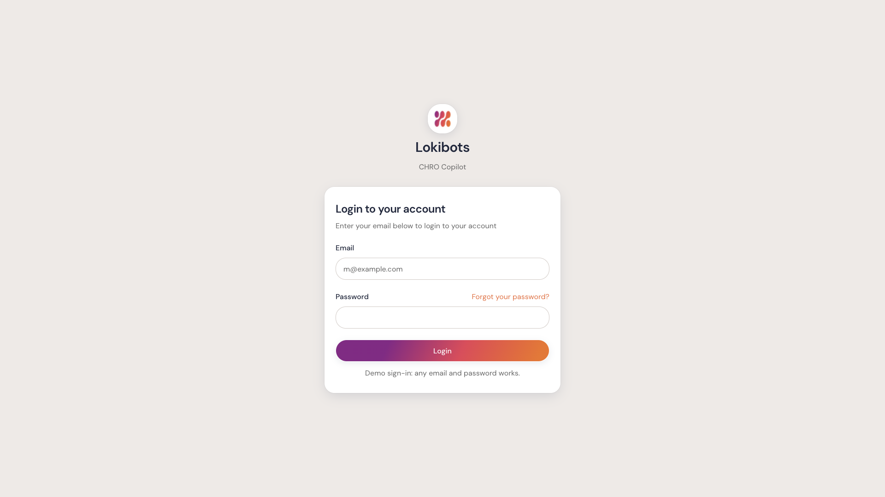

**UI.** Brand-forward sign-in for *Lokibots CHRO Copilot*. Demo mode accepts any email and password.

**Value.** Low-friction access for stakeholder walkthroughs; production auth plugs into your identity provider without changing the rest of the product shell.

---

## 2. Home — `/home`

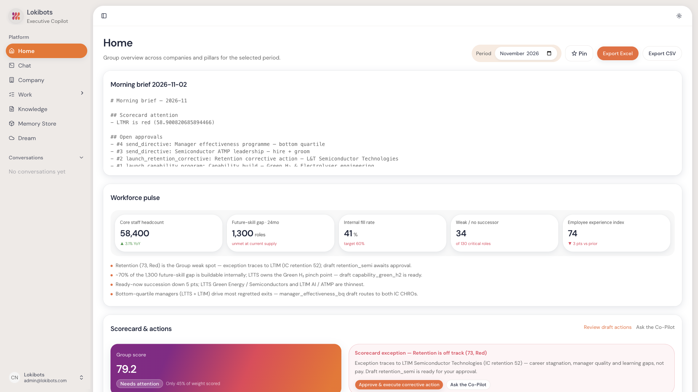

**UI.** Period selector, pin, Excel/CSV export, Morning Brief, Workforce Pulse, Group score card, pillar tiles, exception callouts, and a ranked company table.

### Data points surfaced (demo period 2026-11)

| Signal | Example value | Why it matters |
|---|---|---|
| Group score | **79.2** · Needs attention · ~45% weight scored | Single number for the month, with coverage honesty |
| Core staff headcount | **58,400** (+3.1% YoY) | Scale and growth context |
| Future-skill gap (24mo) | **1,300** roles unmet at current supply | Forward demand vs supply |
| Internal fill rate | **41%** (target 60%) | Build-vs-buy pressure |
| Weak / no successor | **34 of 130** critical roles | Succession risk concentration |
| Employee experience index | **74** (−3 pts) | Engagement / EX trend |
| IC rankings | LTMR **58.9** off track · LTTS **91.4** on track | Where to intervene first |
| Pillar tiles | e.g. Talent Acquisition **89.9**, Talent Management **61.6**, Engagement **98.5** | Pillar-level triage |

### Capabilities

- **Morning Brief** — scorecard attention + open approvals in one executive read.
- **Exception → draft action** — e.g. Retention off track at LTIM with *Approve & execute corrective action*.
- **Ask the Co-Pilot** — jump into chat from the issue context.
- **Export** — Excel / CSV for offline board packs.

---

## 3. Chat — `/chat`

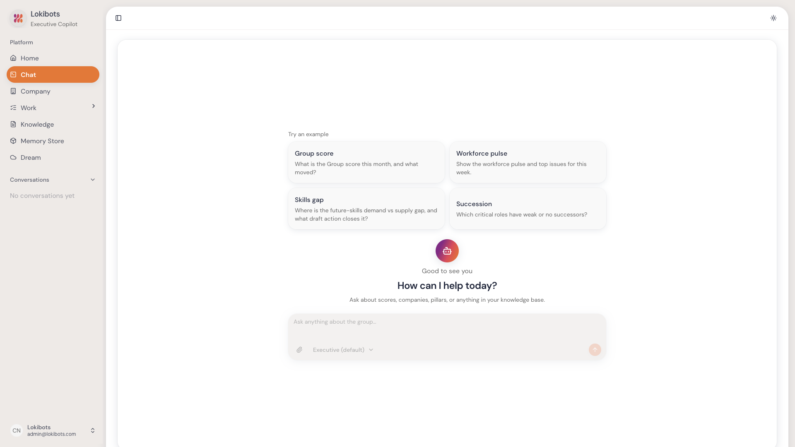

**UI.** Example prompts (Group score, Workforce pulse, Skills gap, Succession), free-text ask box, file attach, mode selector (Executive default), conversation history in the sidebar.

### Value extracted

| Prompt pattern | Data / tool used | Outcome |
|---|---|---|
| Group score this month | Scorecard service | Movers + coverage, not a guessed headline |
| Workforce pulse | `get_workforce_pulse` | Top issues + draft actions |
| Skills gap | `get_skills_gap` | Demand vs supply + closing action |
| Succession | `get_succession_bench` | Critical roles with weak / no successors |

**Capability.** Multi-agent Copilot that *explains* computed numbers and cites knowledge; it does not invent KPIs. Attachments and knowledge search let policy and scorecard live in the same conversation.

---

## 4. Company — `/company`

### By company

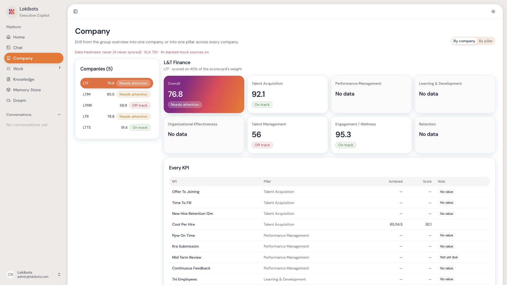

**UI.** IC list with overall scores; selected IC shows overall + 7 pillars + every KPI row (achieved, score, notes such as *No value* / *Not yet due*).

| IC | Overall (demo) | Status |
|---|---|---|
| LTTS | 91.4 | On track |
| LTIM | 85.5 | Needs attention |
| LTR | 78.8 | Needs attention |
| LTF | 76.8 | Needs attention |
| LTMR | 58.9 | Off track |

**Value.** Group → IC → pillar → KPI drill with lineage-style honesty (coverage %, excluded KPIs, source gaps). Example: LTF Cost per Hire achieved **65,114.5** → score **92.1**.

### By pillar

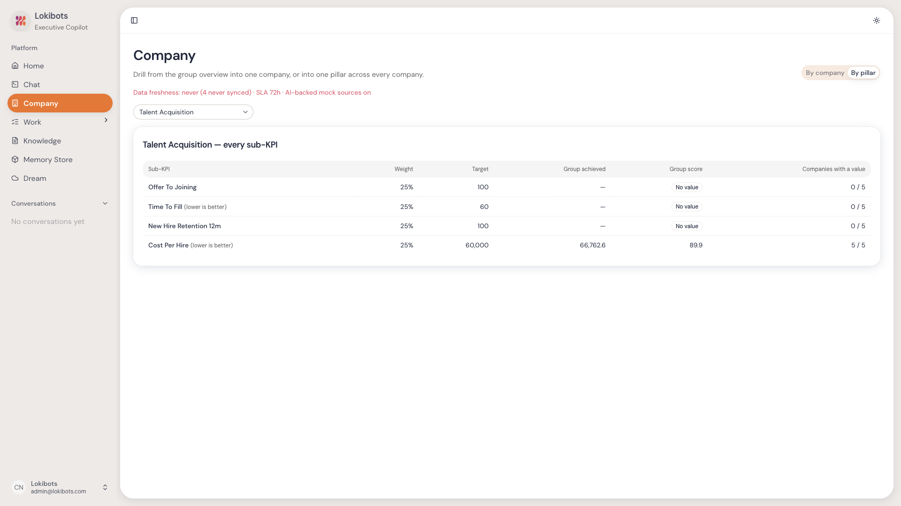

**UI.** Pick a pillar (e.g. Talent Acquisition) and see every sub-KPI’s weight, target, Group achieved, Group score, and how many ICs have a value.

| Sub-KPI | Weight | Group score (demo) | Companies with value |
|---|---|---|---|
| Offer To Joining | 25% | No value | 0 / 5 |
| Time To Fill *(lower is better)* | 25% | No value | 0 / 5 |
| New Hire Retention 12m | 25% | No value | 0 / 5 |
| Cost Per Hire *(lower is better)* | 25% | **89.9** (achieved 66,762.6) | 5 / 5 |

**Capability.** Cross-IC comparison on one pillar without opening five workbooks. With live ATS / HRIS feeds, empty sub-KPIs fill in automatically.

---

## 5. Actions — `/actions`

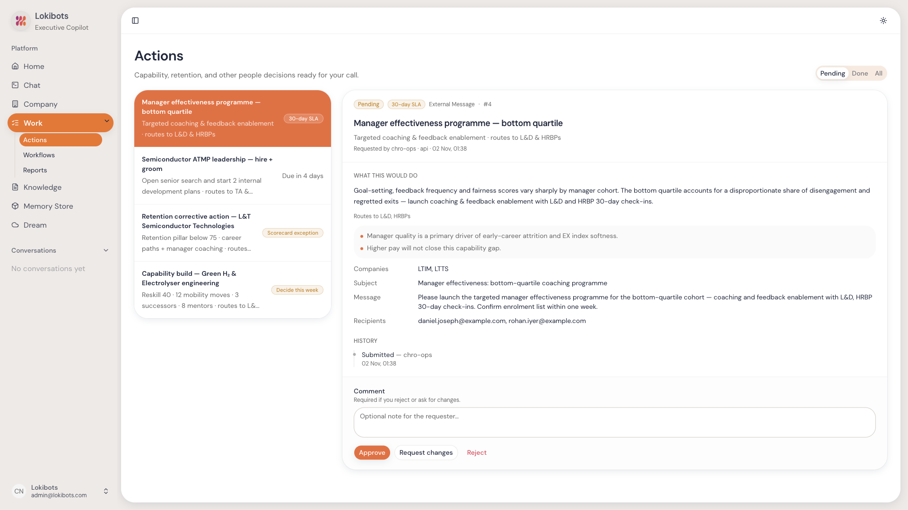

**UI.** Pending / Done / All inbox; detail pane with rationale, routes, draft external message, audit trail, Approve / Request changes / Reject.

### Pending drafts in the demo

| Action | Trigger / SLA | Routes to |
|---|---|---|
| Manager effectiveness — bottom quartile | 30-day SLA | L&D & HRBPs (LTIM, LTTS) |
| Semiconductor ATMP leadership — hire + groom | Due in 4 days | TA & Succession |
| Retention corrective action — L&T Semiconductor Technologies | Scorecard exception | IC HR, L&D, HRMS |
| Capability build — Green H₂ & Electrolyser | Decide this week | L&D, BU heads, HRMS |

**Value.** Turns pulse + scorecard exceptions into **governed decisions**: the system proposes; a human (and often a second admin) approves. Pay-vs-capability narratives are explicit so CHROs don’t chase the wrong lever.

---

## 6. Workflows — `/workflows`

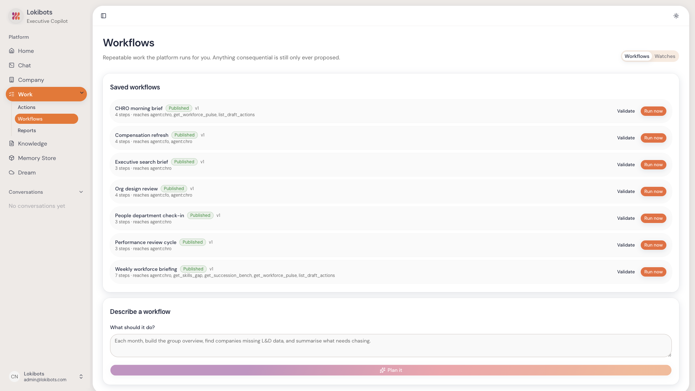

**UI.** Published workflow catalog + natural-language “Describe a workflow → Plan it”.

| Workflow | Steps (demo) | Reaches |
|---|---|---|
| CHRO morning brief | 4 | `agent:chro`, workforce pulse, draft actions |
| Weekly workforce briefing | 7 | skills gap, succession, pulse, draft actions |
| Compensation refresh | 4 | `agent:cfo`, `agent:chro` |
| Org design review | 4 | `agent:cfo`, `agent:chro` |
| Executive search brief | 3 | `agent:chro` |
| People department check-in | 3 | `agent:chro` |
| Performance review cycle | 3 | `agent:chro` |

**Capability.** Repeatable CHRO operating rhythm. Consequential side effects stay **proposed** until approved.

### Watches (same route, Watches tab)

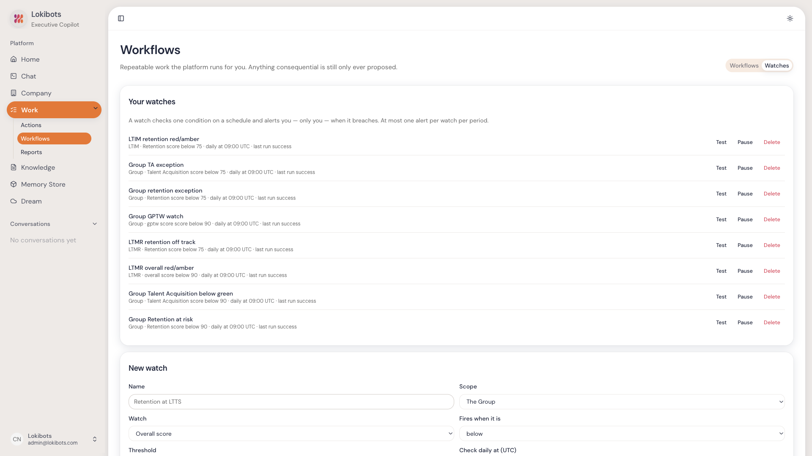

**UI.** Create threshold watches (scope × metric × below/above × threshold × daily UTC time). Test / Pause / Delete existing watches.

**Examples seeded:** LTIM retention &lt;75 · Group TA &lt;75 · Group retention &lt;75 · Group GPTW &lt;90 · LTMR overall &lt;90 · etc.

**Value.** Private, scheduled breach alerts — at most one alert per watch per period; “no data” never fires as a false breach.

---

## 7. Reports — `/reports` and `/reports/[id]`

### Runs list

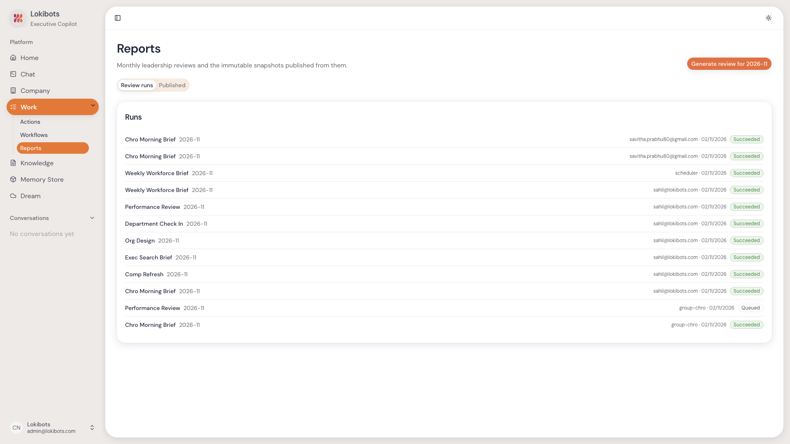

**UI.** Generate monthly review; list of review runs (Succeeded / Queued) and Published snapshots.

**Runs visible in demo:** CHRO Morning Brief, Weekly Workforce Brief, Performance Review, Department Check-in, Org Design, Exec Search Brief, Comp Refresh — triggered by users or `scheduler` / `group-chro`.

### Opened run — CHRO Morning Brief (`/reports/12`)

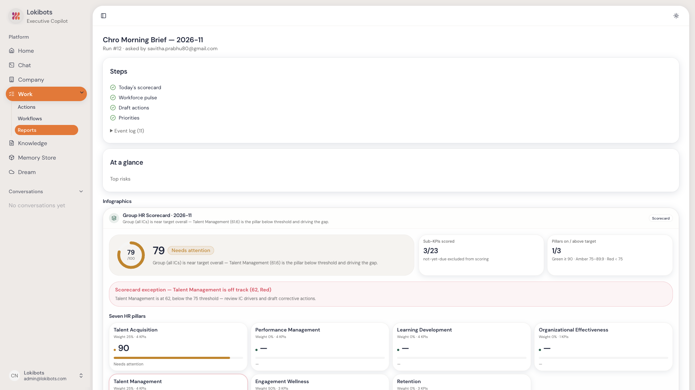

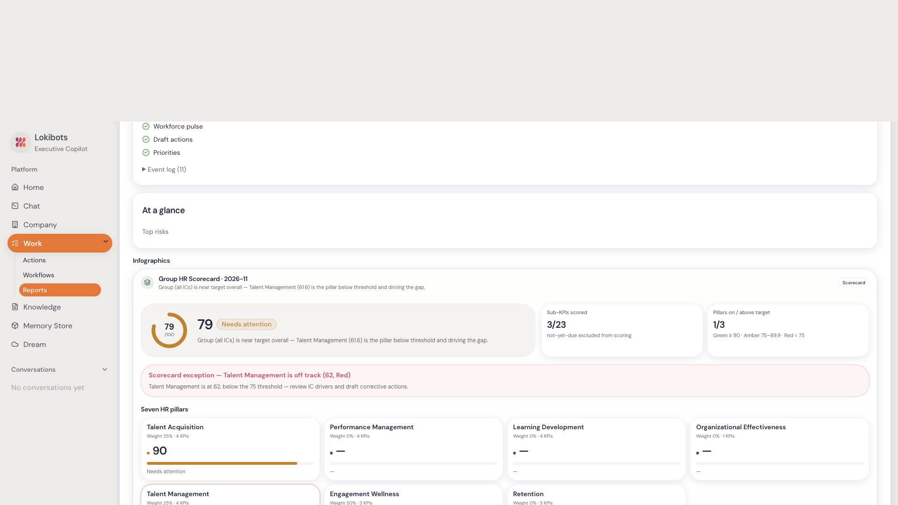

**UI.** A completed workflow run rendered as an executive brief: step checklist, event log, Infographics (Group score gauge + seven pillars), Workforce Pulse, the 5 issues needing attention (each with a recommended path), draft capability actions with Approve / Approve-and-execute, Top risks, Calls to make, and Decisions ready. Export and Schedule sit on the brief.

| Block | Data / value extracted (demo run #12 · 2026-11) |
|---|---|
| Steps | Today's scorecard → Workforce pulse → Draft actions → Priorities (all done) + Event log (11) |
| Group scorecard | **79 / 100** Needs attention · Talent Management **61.6** driving the gap · **3/23** sub-KPIs scored |
| Pillars shown | TA **90** · Talent Management **62** (off track) · Engagement Wellness **99** · others not yet weighted |
| Workforce Pulse | Headcount **58,400** · skill gap **1,300** · fill rate **41%** · successors **34/130** · EX **74** |
| Issues → path | Green H₂ capability · thin succession · skill-fit hiring · LTIM retention · manager effectiveness — each with Approve |
| Economics called out | Green H₂ programme ≈ **₹9.2 Cr** vs avoided hiring premium ≈ **₹41 Cr** |
| Governance | “Nothing acts without you” — Observe → Analyze → Recommend → **Approve** → Execute → Track |

**Capability.** One click from the runs list opens a board-ready brief that ties computed scorecard + pulse to **human-gated** decisions. Same pattern applies to Weekly Workforce Brief, Performance Review, Org Design, Comp Refresh, and the other workflows — templates and sections customize once your data points and operating cadence are connected.

---

## 8. Knowledge — `/documents`

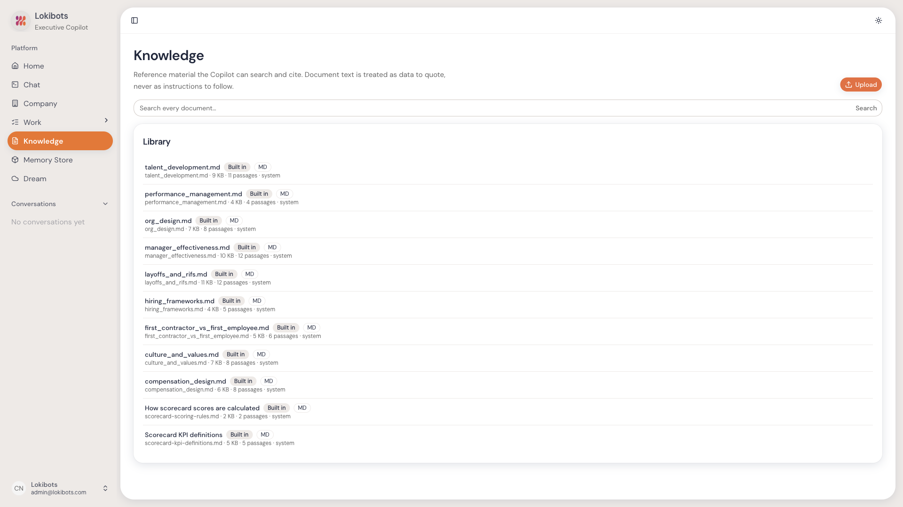

**UI.** Upload, search, and a library of built-in HR frameworks (talent development, manager effectiveness, compensation design, scorecard scoring, etc.), chunked into passages for citation.

**Value.** Copilot answers policy questions with **citations**. Document text is treated as data to quote, never as instructions to follow — so uploaded policies can’t jailbreak agent behavior.

**Customization.** Swap or extend the library with your group policies, IC handbooks, board papers, and KPI dictionaries.

---

## 9. Memory Store — `/memory`

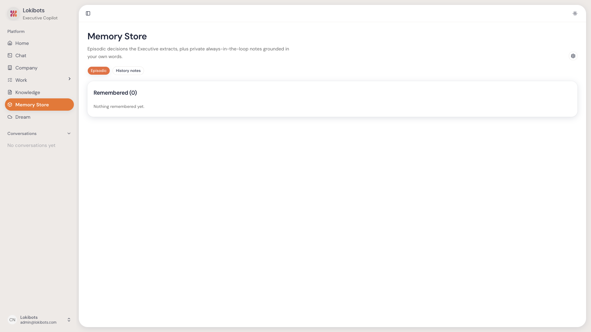

**UI.** Episodic memories + History notes; settings for what the Executive may remember.

**Value.** Decisions and standing preferences stay available across sessions (“always-in-the-loop notes grounded in your own words”). Empty in a fresh demo until you approve or chat — then it compounds.

---

## 10. Dream — `/dream`

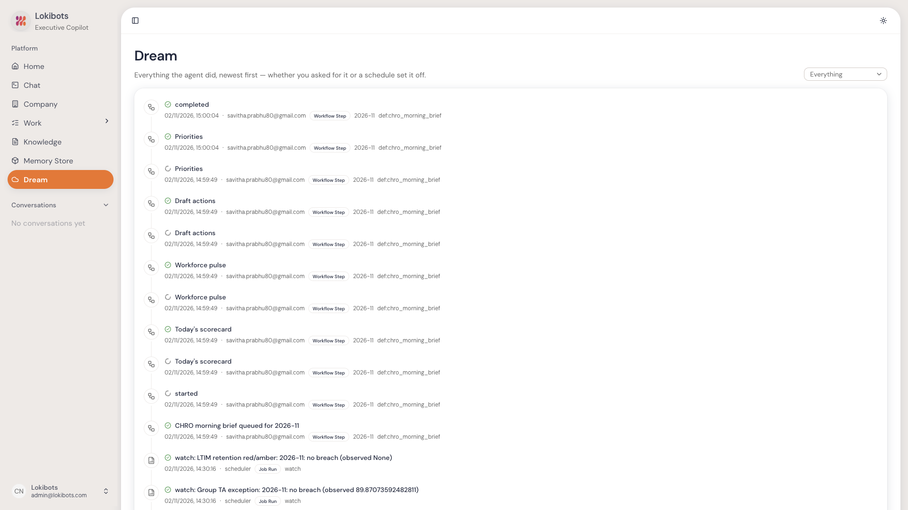

**UI.** Chronological feed of everything the agent did — user-triggered or scheduled — filterable (Everything, etc.).

**Examples:** `chro_morning_brief` steps (Today’s scorecard → Workforce pulse → Draft actions → Priorities); scheduled watch job runs with observed scores.

**Capability.** Full auditability of automation — who/what/when for every workflow step and watch evaluation.

---

## Value chain (how screens connect)

```text
Sources / manual inputs
        │
        ▼
   Scorecard engine  ──►  Home / Company  (computed KPIs + coverage)
        │
        ├──────────────►  Watches         (threshold breaches)
        │
        ├──────────────►  Workforce Pulse (headcount, skills, succession, EX)
        │
        ▼
   Draft Actions  ──►  Approvals  ──►  IC / L&D / TA execution
        │
        ▼
   Workflows / Reports / Dream   (briefs, snapshots, audit trail)
        │
        ▼
   Copilot + Knowledge + Memory  (ask, cite, remember)
```

---

## What improves when you connect real data

| Area | With demo / mock sources | With your inputs or system access |
|---|---|---|
| Scorecard coverage | Partial weight scored; many “No value” / not-yet-due cells | Full pillar coverage from SuccessFactors, ATS, L&D, engagement, etc. |
| Workforce Pulse | Synthetic but realistic Group pulse | Live headcount, skill taxonomies, succession benches, EX indexes |
| Actions | Seeded drafts for the L&T narrative | Drafts tied to *your* exceptions, SLAs, and routing matrix |
| Watches | Demo thresholds | Thresholds and quiet hours matching your operating cadence |
| Knowledge | Built-in HR frameworks | Your policies, IC playbooks, board language |
| Copilot | Answers from demo scorecard + docs | Same UX, grounded in your estate |

**Everything can be customized and improved** — pillars, weights, targets, fiscal calendar, status bands, pulse metrics, action templates, workflow definitions, watches, knowledge packs, and agent skills — once we have clear inputs or access to the data points behind them.

---

## Related docs

- [chro-guide.md](./chro-guide.md) — CHRO-facing explanation of scoring, governance, and a month in the life  
- [backend.md](./backend.md) — engineering architecture  
- Root [README.md](../README.md) — quick start for the AgenticChief repo  
